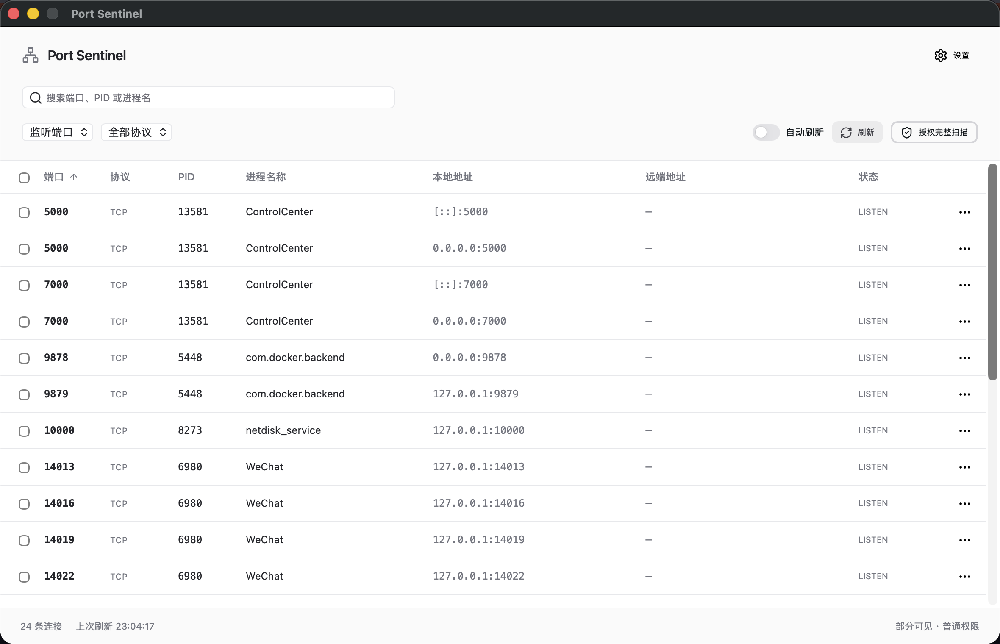

# Port Sentinel

[English](README.md) | [中文](README_zh.md)

Find port conflicts, inspect local connections and manage their processes. Port Sentinel 2 is a Go + Wails v2 desktop app with a React, TypeScript and HeroUI interface.

[Download](https://github.com/Sanjeever/port_sentinel/releases/latest) · [Release notes](docs/releases/)

The original release was featured in Ruan YiFeng's [Technology Enthusiasts Weekly (Issue 382)](https://github.com/ruanyf/weekly/blob/master/docs/issue-382.md?plain=1#L187). [Original release article](https://sanjeev.top/en/posts/2026/01/15-port-sentinel-release) describes the earlier Flutter version.

## Features

- View TCP/UDP and IPv4/IPv6 listeners, bindings or all connections. The table keeps the local address and state visible in narrow windows.
- Press **⌘F** on macOS or **Ctrl+F** on Windows and Linux to search by port, PID or process name. Exact port and PID matches appear first. Process details show the selected connection and available process information, including the executable path, working directory and current parent chain.
- Select filtered rows and end deduplicated processes after confirmation. Clear selections outside the current filters separately. Graceful exit and force termination have separate confirmations. Results show the process outcome and what the recheck found on its listening or bound endpoints.
- Configurable automatic refresh.
- English and Simplified Chinese; light, dark and system themes; saved local preferences and window size.
- Official Release update checks, release notes, cancellable downloads and confirmed installation/restart. Closing the window exits the app.

## Screenshot



## Requirements

| Platform | Package | Runtime requirements |
| --- | --- | --- |
| Windows 10/11 amd64 | Windows amd64 `.zip` | Microsoft Edge WebView2 Runtime |
| macOS 12+ Intel / Apple Silicon | macOS Universal `.zip` | System WebKit; install the complete `.app` |
| Ubuntu 22.04/24.04 amd64 desktop | Linux amd64 `.tar.gz` | GTK 3, WebKitGTK 4.1; polkit and a graphical authentication agent for privileged actions |

These are support targets. Other Linux distributions require compatible desktop dependencies and have not been validated. Platform builds and automated tests do not certify desktop interaction, system authorization or installed-app upgrades; see the [validation record and remaining checks](docs/development.md#历史验证记录与待验收边界).

Packages are portable archives. Extract the whole package to a writable location before running. Without signing credentials, macOS builds are ad hoc signed and not notarized; Windows builds are unsigned. Follow your operating system's approval process for downloaded applications. Flutter 1.x users must install v2 manually.

## Development

Set up Go, Node, pnpm and the platform dependencies in the [development guide](docs/development.md). From the repository root, start the desktop app in PowerShell on Windows or a terminal on macOS and Linux:

```sh
pnpm dev
```

```sh
pnpm build -clean
sh scripts/check.sh
```

The launcher installs the matching Wails CLI into `.tools/`. Run the check script in Git Bash on Windows. For macOS Universal builds, isolated desktop testing, configuration recovery and release preparation, see the development guide. Default local builds have update checks and installation disabled.

## Project structure and documentation

- `internal/` — scanning, process operations, authorization, settings and updates.
- `main.go`, `app.go` — desktop lifecycle and Go/frontend bridge.
- `frontend/src/` — interface, localization and desktop API adapter.
- [Architecture and behavior constraints](docs/architecture.md) — design rationale, contracts and code/test navigation (Chinese).
- [Development and releases](docs/development.md) — setup, platform caveats, validation and publishing (Chinese).
- [AGENTS.md](AGENTS.md) — Coding Agent boundaries and documentation consistency rules (Chinese).
- [Release notes](docs/releases/) and [Flutter 1.x changelog](CHANGELOG.md) — version history.

## Note on Permissions

Keep the main window at ordinary privileges. Ordinary scans show the visible subset. An explicit authorized scan, or a confirmed operation that encounters permission denial, requests one-time authorization through UAC, the macOS administrator dialog or polkit. No resident privileged service or administrator password storage is installed. Automatic refresh never asks for authorization, and system protections can still block access.

Ending a process affects all of its connections, including unselected ports. The default requests graceful exit; Windows targets without a suitable window report that graceful exit is unavailable. A still-running target can be force-ended after a separate confirmation. The app does not recursively terminate process trees.

Preferences are stored in the current user's OS configuration directory. Corrupt configuration and write errors remain visible, and corrupt files are not automatically replaced. Search text, selections and authorization are not restored across launches. File locations and recovery steps are in the development guide.

## Updates

Release builds periodically check this repository's stable GitHub Releases. Automatic checks can be disabled, and manual checks are available in Settings. A new version marks Settings; downloading and restarting require confirmation. Downloads can be cancelled. Replacement or startup failure attempts to restore the old program. Installation needs a writable directory; updates never request administrator privileges.

## License

[MIT](LICENSE)
