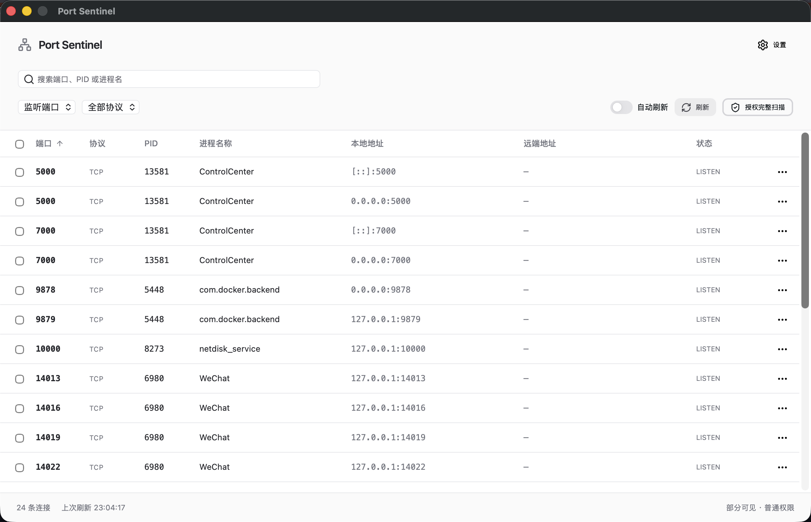

# 端口哨兵

定位端口冲突、查看本地连接并管理相关进程。Port Sentinel 2 使用 Go + Wails v2，界面采用 React、TypeScript 和 HeroUI。

[English](README.md) | [中文](README_zh.md)

[下载](https://github.com/Sanjeever/port_sentinel/releases/latest) · [2.0.0 更新日志](docs/releases/2.0.0.md)

早期版本已收录于阮一峰的[《科技爱好者周刊（第 382 期）》](https://github.com/ruanyf/weekly/blob/master/docs/issue-382.md?plain=1#L187)。[早期发布介绍](https://sanjeev.top/posts/2026/01/15-port-sentinel-release)描述的是原 Flutter 版本。

## 功能特性

- 查看 TCP/UDP、IPv4/IPv6、监听端口或全部连接，以及本地/远端地址、状态、PID、进程名称和可读取的可执行文件路径。
- 按端口、PID、进程名称搜索，筛选协议、数值排序、行菜单、复制和进程详情。
- 全选当前筛选结果，按进程去重后确认结束。正常退出与强制结束分开确认，执行前复核进程身份，执行后重新扫描实际连接。
- 自动刷新默认开启，间隔默认 5 秒，可选 2、5、10、30 秒。
- 简体中文和英文，浅色、深色和跟随系统主题，保存本地设置及窗口大小。
- 正式 Release 更新检查、日志、可取消的下载，以及确认后的安装和重启。关闭窗口即退出。

## 截图



## 系统要求

| 平台 | 安装包 | 运行依赖 |
| --- | --- | --- |
| Windows 10/11 amd64 | `port-sentinel_2.0.0_windows_amd64.zip` | Microsoft Edge WebView2 Runtime |
| macOS 12+ Intel / Apple Silicon | `port-sentinel_2.0.0_darwin_universal.zip` | 系统 WebKit，安装完整 `.app` |
| Ubuntu 22.04/24.04 amd64 桌面 | `port-sentinel_2.0.0_linux_amd64.tar.gz` | GTK 3、WebKitGTK 4.1；提权需要 polkit 与图形认证代理 |

其他 Linux 发行版需要兼容的桌面依赖，尚未验证。macOS 两种架构均以 12.0 为构建目标。为兼顾旧版系统 WebView，前端采用 Tailwind 3.4 和 HeroUI 2。原生 CI 已覆盖 Windows、macOS Universal 和两个 Ubuntu 版本；Windows/Linux 图形桌面、macOS 12 与 Intel 设备运行、真实系统授权及已安装应用升级仍需人工验证。

下载后将整个压缩包解压到可写位置再运行。未提供签名凭据时，macOS 包使用临时签名且未经公证，Windows 包未签名；请按系统要求批准下载的应用。Flutter 1.x 用户需要手动安装 v2。

## 开发

使用 Go 1.23.12、Node 26、pnpm 11.20.0 与 Wails CLI v2.12.0。macOS 需要 Xcode Command Line Tools，Windows 需要 WebView2，Ubuntu 构建需要 `libgtk-3-dev` 与 `libwebkit2gtk-4.1-dev`。

```sh
go install github.com/wailsapp/wails/v2/cmd/wails@v2.12.0
pnpm --dir frontend install --frozen-lockfile
sh scripts/desktop.sh dev
```

```sh
sh scripts/check.sh
sh scripts/desktop.sh build -clean
# macOS Universal：
sh scripts/desktop.sh build -clean -platform darwin/universal
```

Windows 在 Git Bash 中运行脚本。`check.sh` 先执行前端类型检查、测试和真实构建，再执行 Go 测试/vet 与版本检查。桌面脚本将 macOS CGO/链接目标设为 12.0，并使用外部链接解决 Go 1.23 在 macOS 26 上的兼容问题。在 macOS 26 安装 Wails CLI 时，也在安装命令前添加 `GOFLAGS=-ldflags=-linkmode=external`。Linux 检查和构建统一使用 `webkit2_41`。

Wails 在 dev/build 时生成 `frontend/wailsjs`，也可运行 `sh scripts/desktop.sh generate`。生成绑定和 `frontend/dist` 不提交，业务类型适配器位于 `frontend/src/api.ts`。直接运行 Go 检查前先构建真实前端。开发构建不检查或安装更新；测试开发构建时可将 `PORT_SENTINEL_CONFIG_DIR` 指向隔离目录，正式构建始终使用当前用户配置目录。

平台适配与服务分别位于 `internal/ports`、`internal/privilege`、`internal/service`、`internal/settings`、`internal/update`，桌面桥接为 `app.go`。本仓库独立构建，不依赖参考项目目录。

## 权限说明

主界面以普通权限运行，普通扫描显示当前可见范围。主动授权扫描，或已经确认的操作遇到权限不足时，通过 UAC、macOS 管理员对话框或 polkit 启动一次性辅助进程。辅助进程接受扫描/进程请求，不接受任意命令；不安装常驻高权限服务，不保存管理员密码。自动刷新不会请求授权，系统保护仍可能阻止访问。

结束进程会影响它的全部连接，包括未选中的端口。默认请求正常退出；Windows 目标没有适用窗口时，会明确报告不支持正常退出。仍在运行的目标可另行确认强制结束，不递归终止进程树。

设置保存在当前用户的系统配置目录下的 `Port Sentinel/settings.json`。配置损坏与写入失败会显示错误，损坏文件不会被自动覆盖。搜索词、勾选项和授权状态不跨启动保存。

## 更新与发布

正式构建默认启动约 30 秒后检查本仓库正式 Release，之后每 6 小时检查一次，可在设置中关闭。发现新版本在设置入口显示标记，下载和重启需要确认，下载可取消。替换或启动失败时尝试恢复旧程序。安装目录必须可写；更新不会请求管理员权限。签名/公证包安装、真实系统授权和完整升级仍需平台实测，不能用单元测试替代。

版本源为 `frontend/package.json`。先编写双语 `docs/releases/<version>.md`，再运行 `node scripts/version.mjs bump <version>`，将两个版本文件与日志一起提交。push/PR CI 检查 Windows、macOS Universal 和 Ubuntu 22.04/24.04。`v*` 标签触发三平台发布构建，所有安装包成功后公开 Release；正文与应用更新窗口复用同一份 Markdown。可选 macOS 签名凭据见 [scripts/sign-macos.sh](scripts/sign-macos.sh)，凭据部分配置会使发布失败。

## 许可证

[MIT](LICENSE)
